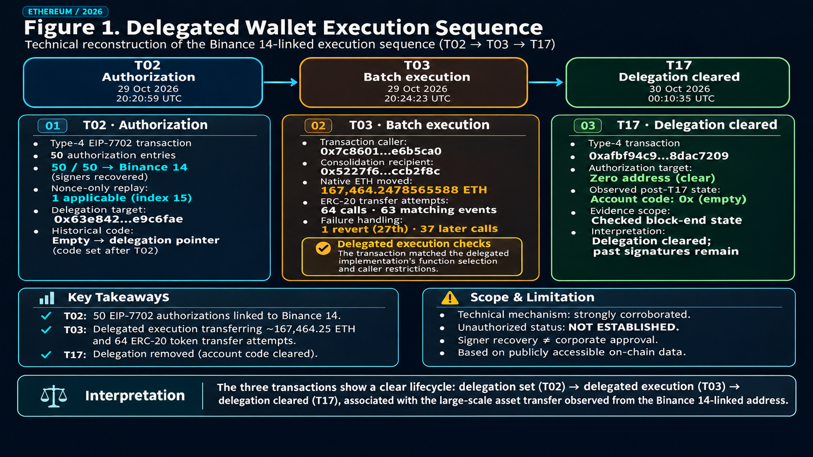
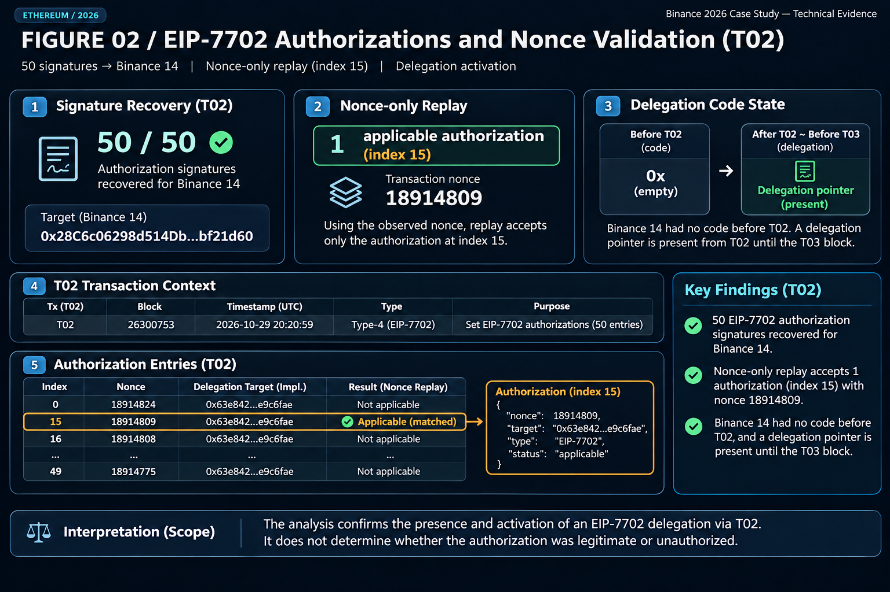
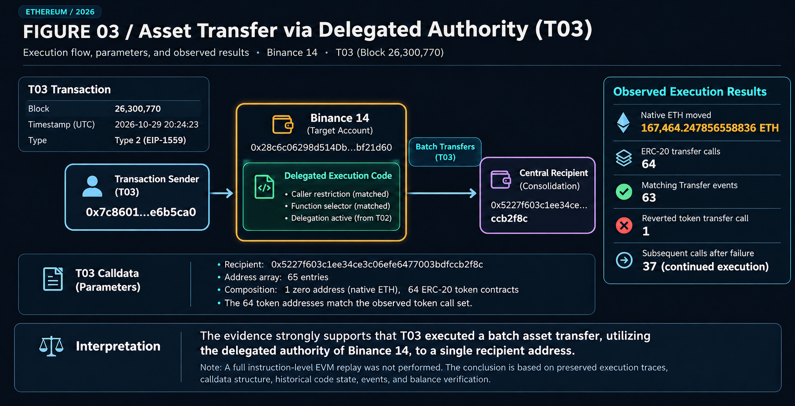
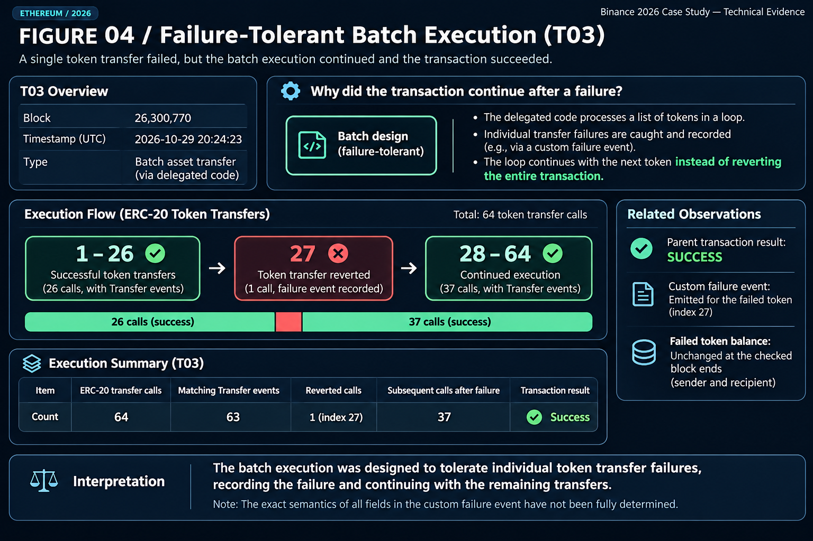
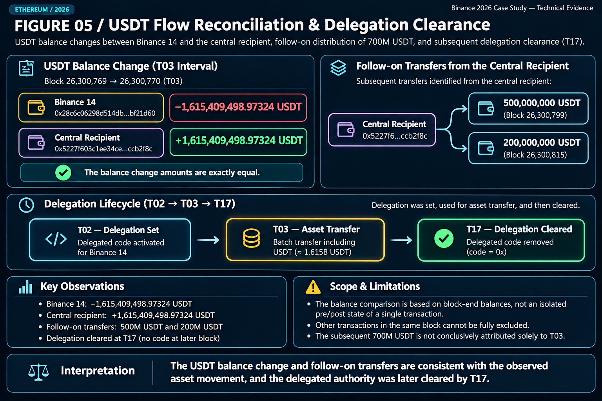
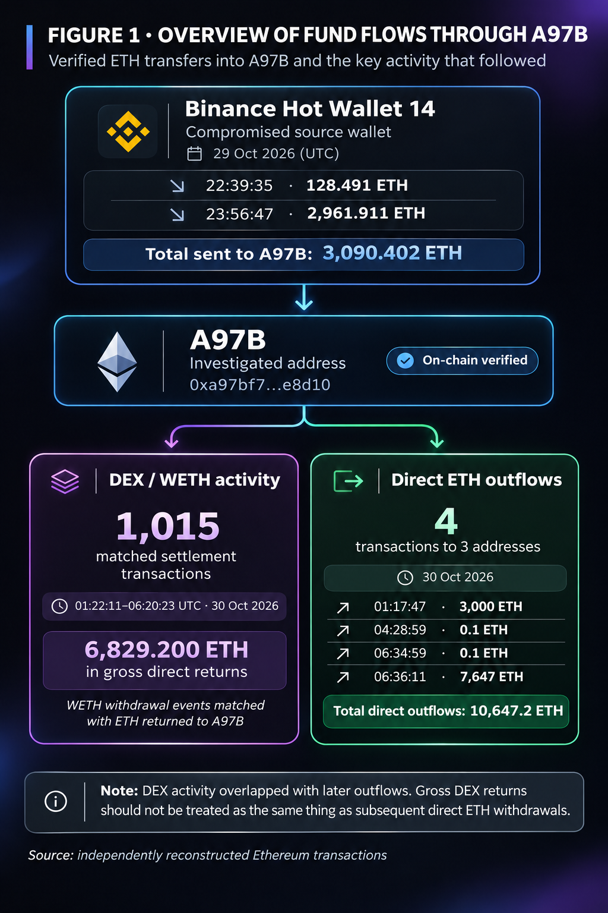
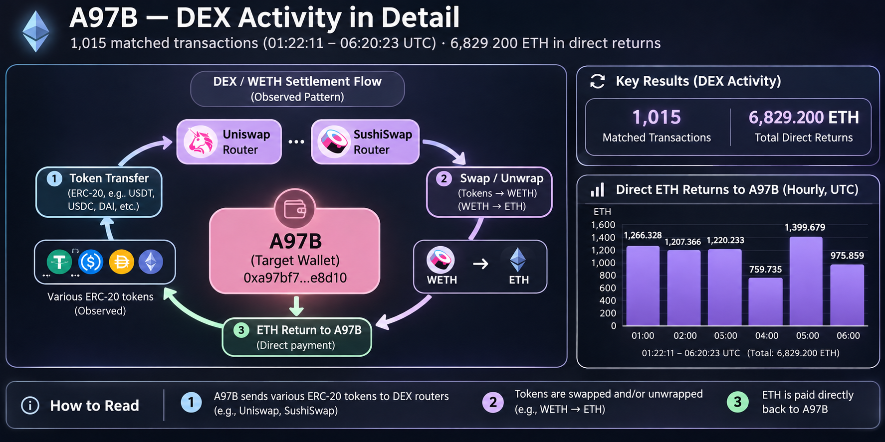
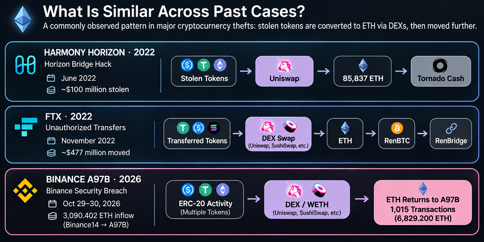

# Binance 2026 — Independent On-Chain Investigation

*EIP-7702 Delegated Execution, A97B DEX Settlement, and ETH Movement Reconstruction*

**Independent On-Chain Forensic Research | Ethereum | October 2026**

> **Research status:** Two published, scope-limited reconstructions. The delegated execution mechanism and selected downstream ETH movements are documented; complete incident-fund provenance, beneficial ownership, and incident-wide conservation remain unresolved.

## Master Investigation Overview

This publication brings together two completed, scope-limited investigations of Ethereum transactions associated with the October 2026 Binance security incident.

The objective is to reconstruct observable transaction mechanisms and asset movements while distinguishing verified blockchain evidence from external incident attribution and unresolved questions.

### Research at a Glance

| Research area | Audited observations |
|---|---|
| EIP-7702 authorization | 50 signatures recovered to the same wallet address; one nonce-applicable authorization in a nonce-only replay |
| Delegated execution | Approximately 167,464 ETH moved; 64 ERC-20 transfer attempts and 63 matching Transfer events |
| Execution behavior | One token-transfer call reverted while later calls continued |
| USDT reconciliation | Corresponding block-end balance changes of approximately 1.615 billion USDT; exclusive downstream provenance unresolved |
| Binance14 to A97B | Two direct ETH transfers totaling 3,090.402 ETH |
| A97B DEX/WETH settlement | 1,015 matched transactions; 6,829.200 ETH in gross direct returns |
| A97B direct ETH outflows | Four transfers totaling 10,647.2 ETH to three recipient addresses |
| External cross-reference | The recipient of a 7,647 ETH transfer appears on the FBI's published incident-related address list |

These figures describe different transaction populations and accounting categories. They must not be summed as an incident loss estimate or treated as a conserved flow of exclusively stolen assets.

### Part I — Delegated Wallet Execution

**[Read Part I: Technical Mechanism and Initial Asset Movements](README.md#executive-summary)**

This investigation reconstructs selected EIP-7702 authorization, delegated execution, and delegation-removal transactions (T02, T03, and T17).

Its evidence includes cryptographic signer recovery, historical account-code checks, execution traces, token-transfer events, and block-end balance comparisons.

**Boundary:** The findings do not independently establish corporate authorization, how signing access was obtained, or complete incident-wide asset movements.

### Part II — A97B DEX Settlement and ETH Returns

**[Read Part II in this Master Report](#part-ii--a97b-dex-settlement-and-eth-movements-full-visual-report)**

**[Read Part II: Transaction-Level Audit](a97b-settlement/README.md)**

This investigation reconstructs two direct Binance14-to-A97B ETH inflows, 1,015 matched WETH Withdrawal and direct ETH-return transactions, and four subsequent direct native ETH outflows.

**[Explore the Illustrated Report and Three Infographics](a97b-settlement/visual-report/README.md)**

The visual report explains the transaction chronology, DEX/WETH settlement observations, historical comparisons, and evidentiary limitations for a wider audience.

**Boundary:** The 6,829.200 ETH gross direct returns are not established as exclusively stolen assets. The separate 10,647.2 ETH outflows cannot automatically be attributed to those returns.

### Consolidated Research Conclusion

Public blockchain evidence supports a bounded reconstruction of authorization mechanisms, transaction execution, and selected subsequent asset movements.

However, the available evidence does not establish a complete incident-attributed fund ledger, exclusive economic provenance for all observed assets, or the real-world identities of the addresses' controllers.

**Reconstructing how assets moved is not the same as proving how much of that activity originated from stolen funds.**

### Outstanding Questions

- What proportion of the observed downstream asset activity can be attributed to the reported incident?
- Can event-time balances and asset provenance be fully reconciled across the relevant addresses?
- Which downstream transfers can be linked through transaction-level evidence rather than timing or address association alone?
- What remains unknown about the ultimate disposition and beneficial ownership of the assets?

Both published studies remain independent, scope-limited reconstructions. Their findings should not be interpreted as a complete investigation of the reported multi-chain incident.

---

**Original Part I technical report follows below.**

---

## Part I — Delegated Wallet Execution: Full Technical Report

## Executive Summary

On October 29, 2026, Binance experienced a major security incident involving unauthorized withdrawals from its hot wallets. In its official updates published on October 30, Binance reported an estimated impact of approximately **USD 6.3 billion**, with approximately **USD 3 billion frozen on-chain** at that time. These are Binance-reported incident-wide figures, not amounts independently reconstructed in this case study.

**Official sources:** [Binance — Security Incident Update](https://www.binance.com/en-GB/support/announcement/security-incident-update-2026-10-30-c5a8729a97ac486d963784d96c5642d7) · [Binance — Security Incident Update #2](https://www.binance.com/en-GB/support/announcement/security-incident-update-2-2026-10-30-d3306d9dca5243548c813b605e1d1751).

Separately, [Crystal Intelligence's October 30 investigation](https://crystalintelligence.com/investigations/binance-hack-what-we-know-what-teams-should-do-now/) linked Ethereum activity involving an address labeled Binance 14 to the reported incident. This represents third-party analytical attribution, not Binance's transaction-specific confirmation.

This independent investigation focuses on that specific Ethereum transaction sequence rather than the full multi-chain incident.

Using cryptographic signature recovery, historical account-code queries, execution traces, event logs, and token-balance comparisons, the research reconstructed three selected transactions: T02, T03, and T17.

The analysis identified 50 EIP-7702 authorization signatures recovering to the same wallet address, a delegated execution mechanism, and a subsequent batch operation involving approximately 167,464 ETH and 64 ERC-20 token-transfer attempts.

One token-transfer call reverted without preventing the remaining batch operations from continuing.

The technical observations do not independently establish Binance's internal authorization status, how signing access was obtained, who controlled the receiving addresses, or the complete movement of assets across the reported incident.

**Transaction identifiers:** T02, T03, and T17 are internal research labels assigned to selected transactions. They do not represent a complete or consecutively presented list of transactions associated with the incident. The analysis focuses on the authorization, delegated execution, and subsequent delegation-removal stages.

*Figure 1. Overview of the T02–T03–T17 execution sequence.*

## 1. The Initial Question

The investigation began with an Ethereum address commonly labeled Binance 14:

`0x28c6c06298d514db089934071355e5743bf21d60`

The address appears in a historical Binance Proof of Reserves dataset examined during this research. The original dataset's publication provenance still requires independent verification.

A historical address association does not establish corporate control at the incident time or prove that a transaction was unauthorized.

**How could a transaction submitted by one Ethereum address initiate substantial asset movements from another address?**

## 2. T02 — The Authorization Sequence

At block 26,300,753, [T02](https://etherscan.io/tx/0xad99264d5532ae0dd04b2004eebda05f25657e70dacb764f7ac8d4ccd051298b) submitted an EIP-7702 authorization list containing 50 entries.

Independent cryptographic recovery showed that all 50 signatures recovered to the Binance 14 wallet address.

The authorization nonces were arranged in descending order.

A nonce-only replay, accounting for the preceding wallet-originated transaction, identified one applicable authorization at zero-based index 15.

| Authorization result | Entries |
|---|---:|
| Nonce too high | 15 |
| Nonce matched | 1 |
| Nonce too low | 34 |
| **Total** | **50** |

Historical account-code queries identified an empty code state before T02 and an EIP-7702 delegation pointer afterward.

*Figure 2. EIP-7702 authorization recovery and nonce-only replay.*

**Evidence:** [Signer recovery](evidence/technical-audits/GATE_2_ETH_T02_SIGNATURE_RECOVERY_V1.json) · [Nonce-only replay](evidence/technical-audits/GATE_2_ETH_T02_AUTHORIZATION_REPLAY_V1.json) · [Historical code](evidence/technical-audits/GATE_2_ETH_HISTORICAL_CODE_AUDIT_V1.json).

**Boundary:** Cryptographic recovery demonstrates address-level signer correspondence, not corporate approval. The replay models nonce conditions and is not a full EVM execution replay.

## 3. T03 — Delegated Asset Movement

Approximately three minutes later, [T03](https://etherscan.io/tx/0x53bd38b816c23e74134786c29a8c18d792777998a3b9326047b583100e88e2f3) interacted with Binance 14 at block 26,300,770.

Transaction submitter:

`0x7c8601d4645b93cea45f71e118a729332e6b5ca0`

The delegated implementation contained a caller restriction matching this address.

The calldata specified one recipient:

`0x5227f603c1ee34ce3c06efe6477003bdfccb2f8c`

The address array contained 65 entries: one zero address, consistent with a native-ETH marker, and 64 distinct ERC-20 token contracts.

The preserved execution trace identified:

- Approximately **167,464.247856558836135296 ETH** transferred.
- **64** ERC-20 token-transfer calls.
- **63** matching ERC-20 Transfer events.
- **1** reverted token-transfer call.

*Figure 3. Delegated execution and observed asset-transfer calls.*

**Evidence:** [Command consolidation](evidence/technical-audits/GATE_2_ETH_T03_COMMAND_CONSOLIDATION_V1.json) · [Transfer-event audit](evidence/technical-audits/GATE_2_ETH_T03_TRANSFER_EVENT_AUDIT_V1.json) · [Caller restriction](evidence/technical-audits/GATE_2_ETH_T03_CALLER_RESTRICTION_V1.md).

**Boundary:** This strongly corroborates delegated batch execution, but a complete instruction-level EVM replay has not been performed.

## 4. A Failed Transfer That Did Not Stop the Batch

The 27th token-transfer call reverted.

However, 37 subsequent token-transfer calls continued without recorded call errors, and the parent transaction succeeded.

A custom event associated with the failed token appeared in the receipt. Historical checks found unchanged source and recipient balances for that token across the examined block-end states.

*Figure 4. A reverted token call followed by continued batch execution.*

**Evidence:** [Failure-tolerance audit](evidence/technical-audits/GATE_2_ETH_T03_FAILURE_TOLERANCE_V1.json) · [Historical balance audit](evidence/technical-audits/GATE_2_ETH_T03_HISTORICAL_BALANCE_AUDIT_V1.json).

The combined trace and receipt evidence supports failure-tolerant batch processing. The precise interpretation of every custom event field remains unresolved.

## 5. Cross-Checking the USDT Movement

Historical USDT balance queries compared the block immediately preceding T03 with the block containing T03.

| Address | Observed USDT balance difference |
|---|---:|
| Binance 14 | −1,615,409,498.97324 |
| Central recipient | +1,615,409,498.97324 |

The observed differences reconcile exactly.

**Evidence:** [Historical balance audit](evidence/technical-audits/GATE_2_ETH_T03_HISTORICAL_BALANCE_AUDIT_V1.json).

These observations are block-end balance differences, not isolated transaction-level prestate and poststate. Other activity within the block cannot be excluded by this comparison alone.

Two later audited transfers from the central recipient distributed 500 million and 200 million USDT to downstream addresses.

The shared address and chronological order were corroborated. Exclusive economic provenance of the downstream 700 million USDT was not established.

*Figure 5. Historical USDT balance comparison and subsequent transfers.*

**Evidence:** [T03-to-700M linkage audit](evidence/technical-audits/GATE_3_T03_TO_700M_LINKAGE_AUDIT_V1.md) · [First-hop distribution audit](evidence/technical-audits/700M_FIRST_HOP_DISTRIBUTION_AUDIT_V1.md).

Downstream transfers must not be double-counted as additional initial asset outflows.

## 6. T17 — Delegation Removal

A subsequent EIP-7702 transaction, [T17](https://etherscan.io/tx/0xafbf94c92a8d749988411669fa14d4f8866d9b4420b4ebd299f28e958dac7209), was associated with removal of the delegation.

Historical code queries found the earlier delegation code absent at the checked block-end state following T17.

Together, T02, T03, and T17 form an observed sequence of authorization, delegated execution, and subsequent delegation removal.

**Evidence:** [Historical code audit](evidence/technical-audits/GATE_2_ETH_HISTORICAL_CODE_AUDIT_V1.json).

## 7. What the Evidence Does Not Establish

The following questions remain unresolved:

- Whether Binance internally approved the authorizations.
- How access to signing authority was obtained.
- Whether the transactions were unauthorized under corporate records.
- Who controlled the receiving addresses.
- Whether every associated movement belonged to the reported incident.
- The total assets frozen, recovered, or still movable.
- Complete incident-wide, cross-chain fund conservation.

Third-party investigative reporting has linked the Ethereum activity to the reported Binance incident. That external attribution is distinct from independent blockchain observations and does not substitute for Binance's transaction-specific confirmation.

No individual perpetrator or criminal responsibility is identified by this case study.

## 8. Conclusion — What Public Blockchain Evidence Can and Cannot Establish

This investigation demonstrates how publicly accessible blockchain evidence can be used to reconstruct a specific sequence of authorization, delegated execution, asset transfers, and subsequent changes in account state.

Cryptographic signatures, historical code states, transaction traces, receipts, and token-balance records provide complementary forms of evidence. When examined together, they strengthen a bounded technical reconstruction.

However, public blockchain records alone cannot establish corporate authorization, the circumstances under which signing access was obtained, the real-world identities controlling receiving addresses, or the complete economic provenance and ultimate disposition of the assets.

Block-end balance comparisons are not transaction-isolated prestate/poststate measurements, and the audited downstream transfers do not establish exclusive provenance.

The distinction matters: **reconstructing how funds moved is not the same as establishing why they moved, who authorized the movement, or who ultimately benefited.**

The purpose of this case study is to document both the investigative value of public blockchain data and the limits of the conclusions that can responsibly be drawn from it.

This report remains a bounded technical reconstruction, not a complete investigation of the reported Binance incident.

## Research Evidence and Limitations

The technical evidence, methodological limitations, and unresolved attribution questions are documented in the `research/case-binance-2026` branch.

- [Technical evidence assessment](evidence/technical-audits/GATE_2_ETH_TECHNICAL_EVIDENCE_ASSESSMENT_V1.md)
- [Historical evidence reconciliation](evidence/technical-audits/GATE_2_ETH_HISTORICAL_RECONCILIATION_V1.md)
- [T03 to 700M linkage audit](evidence/technical-audits/GATE_3_T03_TO_700M_LINKAGE_AUDIT_V1.md)
- [Publication claims audit](evidence/technical-audits/AXIOM_PUBLICATION_CLAIMS_AUDIT_V1.md)
- [Citation map](evidence/technical-audits/PUBLICATION_CITATION_MAP_V1.csv)
- [Fixed research roadmap](evidence/technical-audits/AXIOM_BINANCE_2026_FIXED_RESEARCH_MAP_V1.md)

**Research disclosure:** Independent, bounded technical case study. Findings reflect the cited evidence and stated methodological limits. Corporate authorization, recipient identity, and incident-wide fund conservation remain unresolved. Credential screening was limited to selected patterns and does not constitute a comprehensive security audit. Corrections will be documented in repository history.

---

## Part II — A97B DEX Settlement and ETH Movements: Full Visual Report

**2026 Binance Security Breach: An Independent On-Chain Reconstruction of 1,015 DEX/WETH Transactions**

*Transaction-Level Analysis of ETH Returns, Direct Outflows, and Fund Provenance Limitations*

### 1. Initial Fund Movements from a Compromised Exchange Wallet

*Figure 1. Observed ETH transfers and settlement activity associated with A97B. Gross ETH returns and direct outflows are separate transaction categories; the diagram does not establish complete fund provenance.*

On October 29, 2026, Binance, one of the world's largest cryptocurrency exchanges, experienced a major security breach.

According to Binance's official incident report, the attacker gained unauthorized access to an internal wallet signing service and exploited Ethereum's EIP-7702 authorization mechanism to transfer digital assets.

Binance reported that approximately **$6.34 billion in digital assets** was affected by the incident.

One significant detail appeared in its official report:

> “The final unauthorized transfer of 2,961.9 ETH finalised on-chain at 23:56 UTC.”

This indicated that the final reported unauthorized ETH transfer was confirmed on-chain at 23:56 UTC, before the malicious delegation authorizations had been fully revoked.

**Source:** [Binance — Initial Findings and Response Update, November 3, 2026](https://www.binance.com/en/blog/community/3229153443759566763)

I began investigating transactions associated with **Binance Hot Wallet 14**, an Ethereum wallet affected by the incident.

Through an independent reconstruction of on-chain transactions, I verified two direct ETH transfers from Binance14 to another Ethereum address, `0xa97bf7…e8d10`, referred to as **A97B**.

- **October 29, 22:39:35 UTC:** 128.491 ETH
- **October 29, 23:56:47 UTC:** 2,961.911 ETH

**Total direct inflows: 3,090.402 ETH.**

But what happened after these funds reached A97B?

That question became the starting point for the next stage of my investigation.

### 2. The First Major Outflow from A97B

At **01:17:47 UTC on October 30**, A97B transferred **3,000 ETH** directly to another Ethereum address.

This was the first major direct ETH outflow identified in the reconstructed timeline.

However, what followed was a more complex sequence of transactions involving decentralized exchange infrastructure.

### 3. Inside 1,015 DEX-Related Transactions

Between **01:22:11 and 06:20:23 UTC**, over approximately five hours, substantial decentralized exchange (DEX) activity was observed in connection with A97B.

Within this activity, I independently reconstructed **1,015 distinct transactions in which WETH Withdrawal events could be reconciled with corresponding native ETH payments made directly back to A97B**.

The results were:

**1,015 matched transactions**

**6,829.200 ETH in gross direct returns**

Multiple DEX router infrastructures were involved, including Uniswap and SushiSwap.

*Figure 2. Transaction-level WETH unwrap and direct ETH-return activity. The 1,015 matched transactions represent reconciled settlement observations, not 1,015 proven repetitions of the same funds.*

WETH, or Wrapped Ether, is a tokenized representation of ETH designed to maintain a 1:1 relationship with the underlying asset. Unwrapping WETH converts it back into native ETH.

In the verified transactions, I was able to reconcile WETH Withdrawal events with the corresponding direct ETH payments received by A97B.

Importantly, **this does not mean that the same ETH was circulated 1,015 times, nor does it establish that all 6,829 ETH originated from the Binance theft.**

What the evidence establishes is the observed transaction execution structure and direct ETH return amounts across these 1,015 transactions.

### 4. Why Did This Activity Attract My Attention?

DEX-based asset conversions have also been observed in previous major cryptocurrency theft investigations.

*Figure 3. Historical comparison based on published investigations of Harmony Horizon Bridge and FTX, alongside the independently reconstructed A97B transaction activity. Similar mechanisms do not establish common attribution.*

#### The 2022 Harmony Horizon Bridge Hack

In June 2022, approximately **$100 million in cryptocurrency assets** was stolen from Harmony's Horizon Bridge.

According to blockchain analytics firm Elliptic, the attacker used Uniswap to convert various stolen Ethereum-based assets into a total of **85,837 ETH**.

The ETH was subsequently transferred into Tornado Cash over the following days.

Elliptic described this type of asset conversion as a technique that can be used to reduce the risk of stolen assets being seized or frozen.

**Source:** [Elliptic — The Top Crypto Hacks of 2022](https://www.elliptic.co/insights/the-top-crypto-hacks-of-2022/)

#### The 2022 FTX Unauthorized Transfers

In November 2022, approximately **$477 million in cryptoassets** was moved from FTX wallets through suspected unauthorized transactions.

Elliptic reported that most of the tokens involved were converted into ETH through decentralized exchanges within hours.

Such conversions can be used to avoid freezing mechanisms available to the issuers of certain digital assets, particularly centralized stablecoins.

**Source:** [Elliptic — $477 Million in Unauthorized Transfers from FTX](https://www.elliptic.co/insights/477-million-in-unauthorized-transfers-from-ftx/)

#### Why Convert Different Assets into ETH?

Unlike certain centrally issued tokens, such as USDT and USDC, whose issuers can restrict transfers associated with specific addresses, native ETH does not have an equivalent issuer-controlled blacklist mechanism.

Consequently, converting stolen, potentially freezeable tokens into ETH can be used to circumvent certain asset-freezing controls.

However, converting assets into ETH does not make the funds untraceable. ETH transactions remain visible on the blockchain and may be investigated by exchanges, law enforcement agencies, and blockchain analytics firms.

In connection with the October 2026 Binance incident, the FBI also stated in its October 31 public alert that stolen assets were being converted primarily into ETH and warned that further laundering through DeFi and instant swap services was expected.

**Source:** [FBI — North Korea Responsible for $6 Billion+ Binance Attack](https://www.fbi.gov/investigate/cyber/alerts/2026/north-korea-responsible-for-6-billion-binance-attack)

These historical examples and official warnings provided a reason to examine A97B's DEX-related activity more closely.

Nevertheless, **similar transaction mechanisms alone do not establish a common attacker, criminal intent, or shared provenance for all assets involved.**

### 5. Where Did the ETH Go?

I separately reconstructed the direct native ETH outflows from A97B and identified four transactions on October 30, 2026.

| Time (UTC) | ETH Transferred | Recipient Address |
|---|---:|---|
| 01:17:47 | 3,000 ETH | `0xc2096a…2d850a` |
| 04:28:59 | 0.1 ETH | `0xa3b3de…48886f` |
| 06:34:59 | 0.1 ETH | `0x54401f…4bc942` |
| 06:36:11 | 7,647 ETH | `0x54401f…4bc942` |

**Total: 10,647.2 ETH transferred directly to three recipient addresses.**

Notably, the final two transactions were sent to the same recipient address.

This led to an important cross-reference with external evidence.

**The address that received the 7,647 ETH transfer, `0x54401f80da…4bc942`, also appears on the FBI's official list of addresses associated with the Binance theft.**

In its public alert, the FBI described the listed addresses as holding, or having previously held, assets from the theft and as being operated by or closely connected to North Korea's TraderTraitor actors.

However, inclusion on this list does not independently establish that the address was frozen or that its beneficial owner has been publicly identified.

**Source:** [FBI — Official Alert and Ethereum Address List](https://www.fbi.gov/investigate/cyber/alerts/2026/north-korea-responsible-for-6-billion-binance-attack)

Blockchain analytics firm Bitquery had also previously identified A97B in its public investigation and described an ETH movement at approximately 06:36 UTC on October 30.

I therefore do not claim to have been the first to discover the existence of the 7,647 ETH transfer.

**The contribution of this independent research lies in reconstructing and verifying the granular transaction activity surrounding previously reported addresses and major fund movements, while preserving the underlying evidence in a reproducible format.**

### 6. What Did the Evidence Establish, and What Remains Unresolved?

Through this investigation, I reconstructed the following observations:

- Two direct ETH transfers from Binance14 to A97B.
- 1,015 transactions with reconciled WETH Withdrawal events and corresponding direct ETH returns.
- A total of 6,829.200 ETH in gross direct returns.
- Four direct native ETH outflows to three recipient addresses.
- A match between the recipient of the 7,647 ETH transfer and an address published in the FBI's official incident-related address list.

However, several important questions remain unresolved.

Did all the tokens and ETH processed through A97B actually originate from the Binance theft?

**How far can publicly accessible blockchain data take us in tracing and verifying the movement of stolen funds?**

To investigate this question, I reconstructed individual transactions associated with A97B, reconciled WETH Withdrawal events with direct ETH payments, and traced the immediate recipient addresses of subsequent withdrawals.

The analysis established that **6,829.200 ETH was returned directly to A97B across 1,015 matched transactions**, while **10,647.2 ETH was separately transferred out through four direct transactions to three addresses**.

However, identifying where assets moved is fundamentally different from proving where those assets originally came from.

A97B may have processed assets originating from multiple sources. Based on the evidence collected and the public information reviewed, I could not fully reconstruct the original provenance of every token or the wallet's complete asset inventory at each relevant point in time.

The central conclusion of this investigation is therefore:

**Although publicly available on-chain data allowed me to reconstruct a substantial portion of the observable transaction activity, the evidence currently available was insufficient to determine precisely how much of the assets processed through A97B originated from the Binance theft.**

This does not mean that such analysis is inherently impossible using public blockchain data. Additional provenance verification, historical balance reconstruction, intermediate transaction tracing, and independent evidence cross-checking may be needed.

The 6,829.200 ETH in gross returns and 10,647.2 ETH in direct outflows must not be added together, netted, or treated as verified stolen proceeds without establishing the relevant source-of-funds relationships.

**My objective was not simply to determine how much money had moved, but to understand how much of that movement could actually be demonstrated to originate from stolen funds.**

This investigation helped establish what could be verified and where the available evidence reached its limits.

---

**Independent Financial Crime Research**

Full transaction-level ledgers, methodology, and audit evidence:

[Original A97B Audited Research Report](https://github.com/Sellina95/independent-financial-crime-research/blob/main/publications/binance-2026/a97b-settlement/README.md)

[Bitquery — Binance Investigation](https://www.bitquery.io/investigations/binance-hack)

*This research is an independent analysis of publicly accessible on-chain data. It does not identify or accuse any individual of criminal conduct, nor does it attribute unverified funds to the Binance incident.*

**Detailed transaction audit and evidence:** [A97B Settlement Research](a97b-settlement/README.md)
