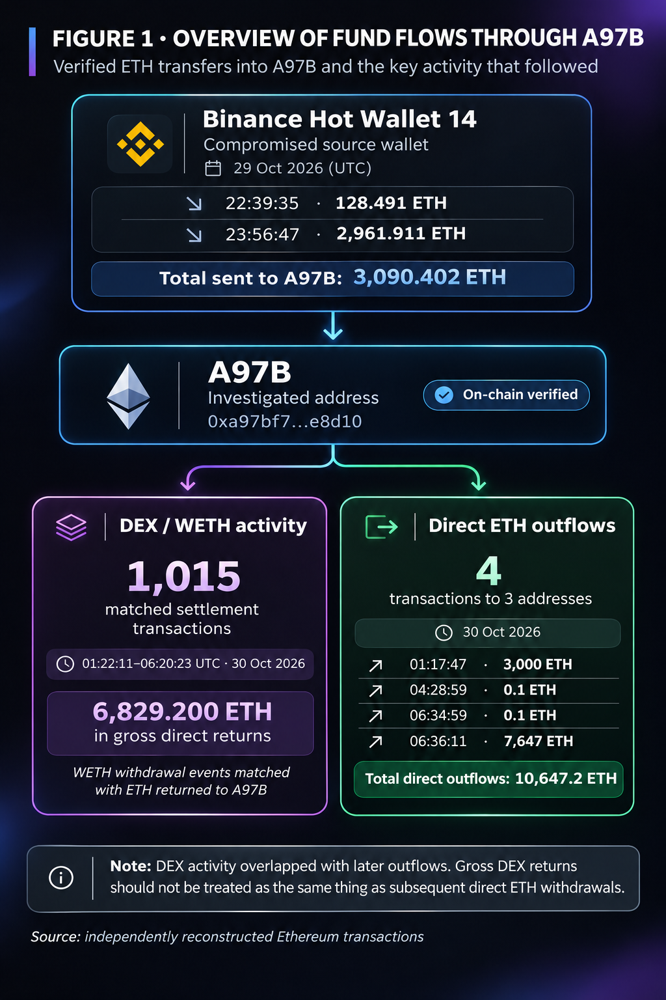
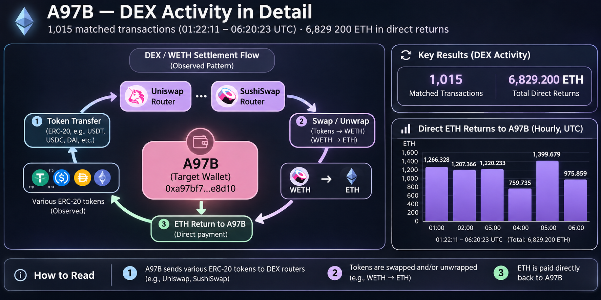
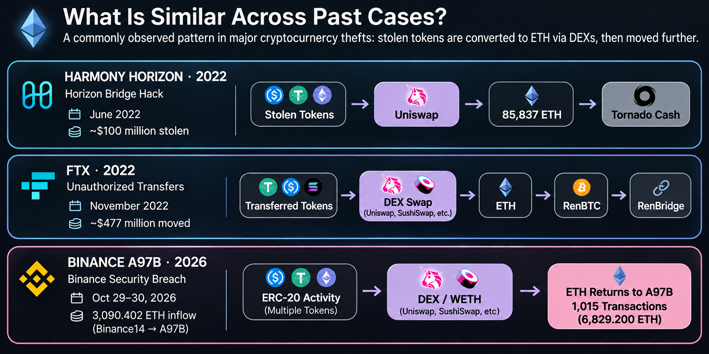

# 2026 Binance Security Breach: An Independent On-Chain Reconstruction of 1,015 DEX/WETH Transactions

*Transaction-Level Analysis of ETH Returns, Direct Outflows, and Fund Provenance Limitations*

## 1. Initial Fund Movements from a Compromised Exchange Wallet

*Figure 1. Observed ETH transfers and settlement activity associated with A97B. Gross ETH returns and direct outflows are separate transaction categories; the diagram does not establish complete fund provenance.*

On October 29, 2026, Binance, one of the world's largest cryptocurrency exchanges, experienced a major security breach.

According to Binance's official incident report, the attacker gained unauthorized access to an internal wallet signing service and exploited Ethereum's EIP-7702 authorization mechanism to transfer digital assets.

Binance reported that approximately **$6.34 billion in digital assets** was affected by the incident.

One significant detail appeared in its official report:

> “The final unauthorized transfer of 2,961.9 ETH finalised on-chain at 23:56 UTC.”

This indicated that the final reported unauthorized ETH transfer was confirmed on-chain at 23:56 UTC, before the malicious delegation authorizations had been fully revoked.

**Source:** [Binance — Initial Findings and Response Update, November 3, 2026](https://www.binance.com/en/blog/community/3229153443759566763)

I began investigating transactions associated with **Binance Hot Wallet 14**, an Ethereum wallet affected by the incident.

Through an independent reconstruction of on-chain transactions, I verified two direct ETH transfers from Binance14 to another Ethereum address, `0xa97bf7…e8d10`, referred to as **A97B**.

- **October 29, 22:39:35 UTC:** 128.491 ETH
- **October 29, 23:56:47 UTC:** 2,961.911 ETH

**Total direct inflows: 3,090.402 ETH.**

But what happened after these funds reached A97B?

That question became the starting point for the next stage of my investigation.

## 2. The First Major Outflow from A97B

At **01:17:47 UTC on October 30**, A97B transferred **3,000 ETH** directly to another Ethereum address.

This was the first major direct ETH outflow identified in the reconstructed timeline.

However, what followed was a more complex sequence of transactions involving decentralized exchange infrastructure.

## 3. Inside 1,015 DEX-Related Transactions

Between **01:22:11 and 06:20:23 UTC**, over approximately five hours, substantial decentralized exchange (DEX) activity was observed in connection with A97B.

Within this activity, I independently reconstructed **1,015 distinct transactions in which WETH Withdrawal events could be reconciled with corresponding native ETH payments made directly back to A97B**.

The results were:

**1,015 matched transactions**

**6,829.200 ETH in gross direct returns**

Multiple DEX router infrastructures were involved, including Uniswap and SushiSwap.

*Figure 2. Transaction-level WETH unwrap and direct ETH-return activity. The 1,015 matched transactions represent reconciled settlement observations, not 1,015 proven repetitions of the same funds.*

WETH, or Wrapped Ether, is a tokenized representation of ETH designed to maintain a 1:1 relationship with the underlying asset. Unwrapping WETH converts it back into native ETH.

In the verified transactions, I was able to reconcile WETH Withdrawal events with the corresponding direct ETH payments received by A97B.

Importantly, **this does not mean that the same ETH was circulated 1,015 times, nor does it establish that all 6,829 ETH originated from the Binance theft.**

What the evidence establishes is the observed transaction execution structure and direct ETH return amounts across these 1,015 transactions.

## 4. Why Did This Activity Attract My Attention?

DEX-based asset conversions have also been observed in previous major cryptocurrency theft investigations.

*Figure 3. Historical comparison based on published investigations of Harmony Horizon Bridge and FTX, alongside the independently reconstructed A97B transaction activity. Similar mechanisms do not establish common attribution.*

### The 2022 Harmony Horizon Bridge Hack

In June 2022, approximately **$100 million in cryptocurrency assets** was stolen from Harmony's Horizon Bridge.

According to blockchain analytics firm Elliptic, the attacker used Uniswap to convert various stolen Ethereum-based assets into a total of **85,837 ETH**.

The ETH was subsequently transferred into Tornado Cash over the following days.

Elliptic described this type of asset conversion as a technique that can be used to reduce the risk of stolen assets being seized or frozen.

**Source:** [Elliptic — The Top Crypto Hacks of 2022](https://www.elliptic.co/insights/the-top-crypto-hacks-of-2022/)

### The 2022 FTX Unauthorized Transfers

In November 2022, approximately **$477 million in cryptoassets** was moved from FTX wallets through suspected unauthorized transactions.

Elliptic reported that most of the tokens involved were converted into ETH through decentralized exchanges within hours.

Such conversions can be used to avoid freezing mechanisms available to the issuers of certain digital assets, particularly centralized stablecoins.

**Source:** [Elliptic — $477 Million in Unauthorized Transfers from FTX](https://www.elliptic.co/insights/477-million-in-unauthorized-transfers-from-ftx/)

### Why Convert Different Assets into ETH?

Unlike certain centrally issued tokens, such as USDT and USDC, whose issuers can restrict transfers associated with specific addresses, native ETH does not have an equivalent issuer-controlled blacklist mechanism.

Consequently, converting stolen, potentially freezeable tokens into ETH can be used to circumvent certain asset-freezing controls.

However, converting assets into ETH does not make the funds untraceable. ETH transactions remain visible on the blockchain and may be investigated by exchanges, law enforcement agencies, and blockchain analytics firms.

In connection with the October 2026 Binance incident, the FBI also stated in its October 31 public alert that stolen assets were being converted primarily into ETH and warned that further laundering through DeFi and instant swap services was expected.

**Source:** [FBI — North Korea Responsible for $6 Billion+ Binance Attack](https://www.fbi.gov/investigate/cyber/alerts/2026/north-korea-responsible-for-6-billion-binance-attack)

These historical examples and official warnings provided a reason to examine A97B's DEX-related activity more closely.

Nevertheless, **similar transaction mechanisms alone do not establish a common attacker, criminal intent, or shared provenance for all assets involved.**

## 5. Where Did the ETH Go?

I separately reconstructed the direct native ETH outflows from A97B and identified four transactions on October 30, 2026.

| Time (UTC) | ETH Transferred | Recipient Address |
|---|---:|---|
| 01:17:47 | 3,000 ETH | `0xc2096a…2d850a` |
| 04:28:59 | 0.1 ETH | `0xa3b3de…48886f` |
| 06:34:59 | 0.1 ETH | `0x54401f…4bc942` |
| 06:36:11 | 7,647 ETH | `0x54401f…4bc942` |

**Total: 10,647.2 ETH transferred directly to three recipient addresses.**

Notably, the final two transactions were sent to the same recipient address.

This led to an important cross-reference with external evidence.

**The address that received the 7,647 ETH transfer, `0x54401f80da…4bc942`, also appears on the FBI's official list of addresses associated with the Binance theft.**

In its public alert, the FBI described the listed addresses as holding, or having previously held, assets from the theft and as being operated by or closely connected to North Korea's TraderTraitor actors.

However, inclusion on this list does not independently establish that the address was frozen or that its beneficial owner has been publicly identified.

**Source:** [FBI — Official Alert and Ethereum Address List](https://www.fbi.gov/investigate/cyber/alerts/2026/north-korea-responsible-for-6-billion-binance-attack)

Blockchain analytics firm Bitquery had also previously identified A97B in its public investigation and described an ETH movement at approximately 06:36 UTC on October 30.

I therefore do not claim to have been the first to discover the existence of the 7,647 ETH transfer.

**The contribution of this independent research lies in reconstructing and verifying the granular transaction activity surrounding previously reported addresses and major fund movements, while preserving the underlying evidence in a reproducible format.**

## 6. What Did the Evidence Establish, and What Remains Unresolved?

Through this investigation, I reconstructed the following observations:

- Two direct ETH transfers from Binance14 to A97B.
- 1,015 transactions with reconciled WETH Withdrawal events and corresponding direct ETH returns.
- A total of 6,829.200 ETH in gross direct returns.
- Four direct native ETH outflows to three recipient addresses.
- A match between the recipient of the 7,647 ETH transfer and an address published in the FBI's official incident-related address list.

However, several important questions remain unresolved.

Did all the tokens and ETH processed through A97B actually originate from the Binance theft?

**How far can publicly accessible blockchain data take us in tracing and verifying the movement of stolen funds?**

To investigate this question, I reconstructed individual transactions associated with A97B, reconciled WETH Withdrawal events with direct ETH payments, and traced the immediate recipient addresses of subsequent withdrawals.

The analysis established that **6,829.200 ETH was returned directly to A97B across 1,015 matched transactions**, while **10,647.2 ETH was separately transferred out through four direct transactions to three addresses**.

However, identifying where assets moved is fundamentally different from proving where those assets originally came from.

A97B may have processed assets originating from multiple sources. Based on the evidence collected and the public information reviewed, I could not fully reconstruct the original provenance of every token or the wallet's complete asset inventory at each relevant point in time.

The central conclusion of this investigation is therefore:

**Although publicly available on-chain data allowed me to reconstruct a substantial portion of the observable transaction activity, the evidence currently available was insufficient to determine precisely how much of the assets processed through A97B originated from the Binance theft.**

This does not mean that such analysis is inherently impossible using public blockchain data. Additional provenance verification, historical balance reconstruction, intermediate transaction tracing, and independent evidence cross-checking may be needed.

The 6,829.200 ETH in gross returns and 10,647.2 ETH in direct outflows must not be added together, netted, or treated as verified stolen proceeds without establishing the relevant source-of-funds relationships.

**My objective was not simply to determine how much money had moved, but to understand how much of that movement could actually be demonstrated to originate from stolen funds.**

This investigation helped establish what could be verified and where the available evidence reached its limits.

---

**Independent Financial Crime Research**

Full transaction-level ledgers, methodology, and audit evidence:

[Original A97B Audited Research Report](https://github.com/Sellina95/independent-financial-crime-research/blob/main/publications/binance-2026/a97b-settlement/README.md)

[Bitquery — Binance Investigation](https://www.bitquery.io/investigations/binance-hack)

*This research is an independent analysis of publicly accessible on-chain data. It does not identify or accuse any individual of criminal conduct, nor does it attribute unverified funds to the Binance incident.*
