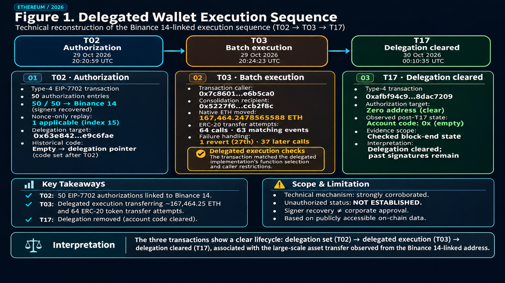
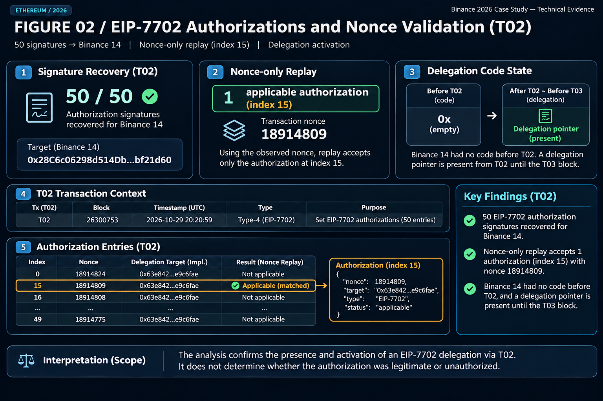
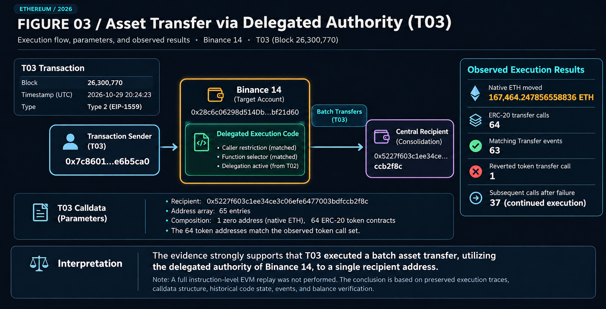
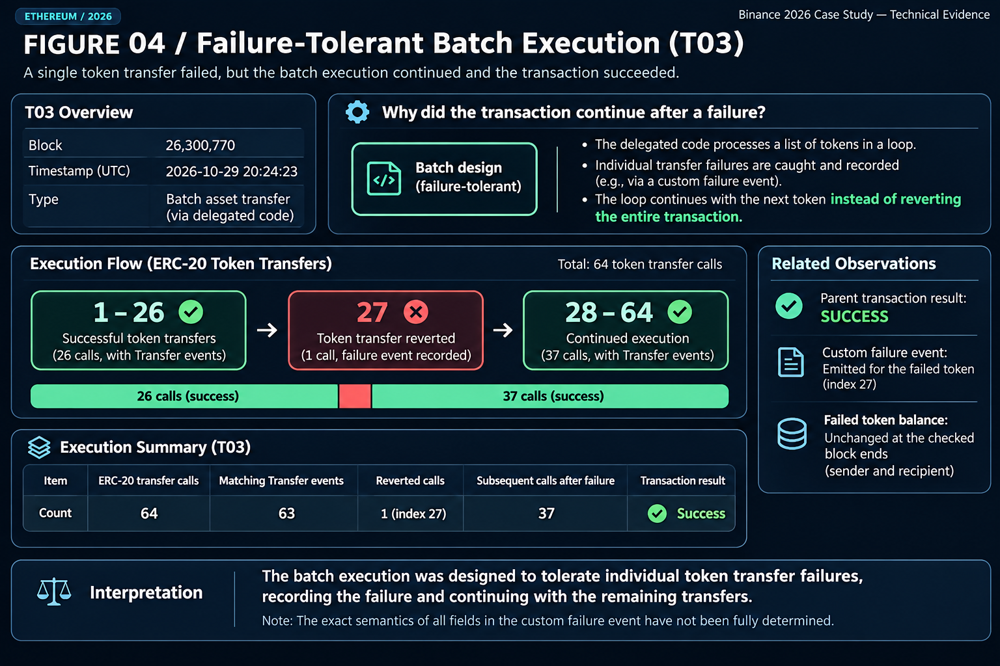
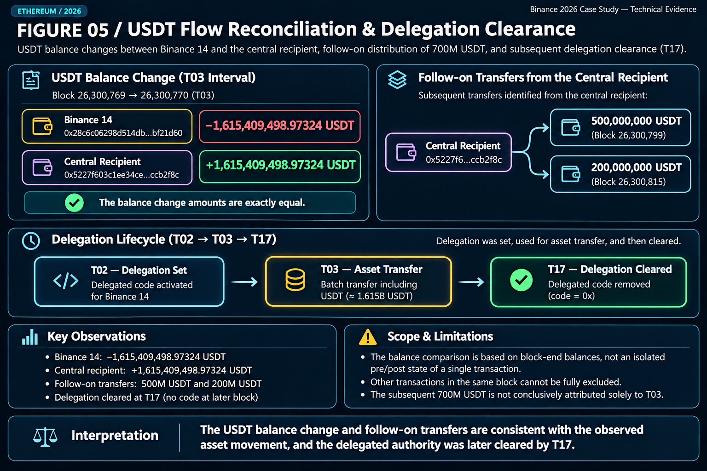

# Binance 2026 — Anatomy of a Delegated Wallet Drain

*An Independent Reconstruction of EIP-7702 Authorization, Batch Execution, and Asset Movements*

**Independent On-Chain Forensic Research | Ethereum | October 2026**

> **Research status:** Technical mechanism strongly corroborated. Official transaction-level incident attribution remains unresolved. This is a bounded technical case study, not a complete incident investigation.

## Executive Summary

On October 29, 2026, a sequence of Ethereum transactions involving an address historically associated with Binance revealed an unusual authorization and asset-transfer mechanism.

Using cryptographic signature recovery, historical account-code queries, execution traces, event logs, and token-balance comparisons, this investigation independently reconstructed three transactions: T02, T03, and T17.

The analysis identified 50 EIP-7702 authorization signatures recovering to the same wallet address, a delegated execution mechanism, and a subsequent batch operation involving approximately 167,464 ETH and 64 ERC-20 token contracts.

One token-transfer call reverted without preventing the remaining batch operations from continuing.

The technical observations do not establish whether Binance internally authorized these transactions or who controlled the receiving addresses.

*Figure 1. Overview of the T02–T03–T17 execution sequence.*

## 1. The Initial Question

The investigation began with an Ethereum address commonly labeled Binance 14:

`0x28c6c06298d514db089934071355e5743bf21d60`

The address appears in a historical Binance Proof of Reserves dataset examined during this research. The original dataset's publication provenance still requires independent verification.

A historical address association does not establish corporate control at the incident time or prove that a transaction was unauthorized.

**How could a transaction submitted by one Ethereum address initiate substantial asset movements from another address?**

## 2. T02 — The Authorization Sequence

At block 26,300,753, [T02](https://etherscan.io/tx/0xad99264d5532ae0dd04b2004eebda05f25657e70dacb764f7ac8d4ccd051298b) submitted an EIP-7702 authorization list containing 50 entries.

Independent cryptographic recovery showed that all 50 signatures recovered to the Binance 14 wallet address.

The authorization nonces were arranged in descending order.

A nonce-only replay, accounting for the preceding wallet-originated transaction, identified one applicable authorization at zero-based index 15.

| Authorization result | Entries |
|---|---:|
| Nonce too high | 15 |
| Nonce matched | 1 |
| Nonce too low | 34 |
| **Total** | **50** |

Historical account-code queries identified an empty code state before T02 and an EIP-7702 delegation pointer afterward.

*Figure 2. EIP-7702 authorization recovery and nonce-only replay.*

**Evidence:** [Signer recovery](GATE_2_ETH_T02_SIGNATURE_RECOVERY_V1.json) · [Nonce-only replay](GATE_2_ETH_T02_AUTHORIZATION_REPLAY_V1.json) · [Historical code](GATE_2_ETH_HISTORICAL_CODE_AUDIT_V1.json).

**Boundary:** Cryptographic recovery demonstrates address-level signer correspondence, not corporate approval. The replay models nonce conditions and is not a full EVM execution replay.

## 3. T03 — Delegated Asset Movement

Approximately three minutes later, [T03](https://etherscan.io/tx/0x53bd38b816c23e74134786c29a8c18d792777998a3b9326047b583100e88e2f3) interacted with Binance 14 at block 26,300,770.

Transaction submitter:

`0x7c8601d4645b93cea45f71e118a729332e6b5ca0`

The delegated implementation contained a caller restriction matching this address.

The calldata specified one recipient:

`0x5227f603c1ee34ce3c06efe6477003bdfccb2f8c`

The address array contained 65 entries: one zero address, consistent with a native-ETH marker, and 64 distinct ERC-20 token contracts.

The preserved execution trace identified:

- Approximately **167,464.247856558836135296 ETH** transferred.
- **64** ERC-20 token-transfer calls.
- **63** matching ERC-20 Transfer events.
- **1** reverted token-transfer call.

*Figure 3. Delegated execution and observed asset-transfer calls.*

**Evidence:** [Command consolidation](GATE_2_ETH_T03_COMMAND_CONSOLIDATION_V1.json) · [Transfer-event audit](GATE_2_ETH_T03_TRANSFER_EVENT_AUDIT_V1.json) · [Caller restriction](GATE_2_ETH_T03_CALLER_RESTRICTION_V1.md).

**Boundary:** This strongly corroborates delegated batch execution, but a complete instruction-level EVM replay has not been performed.

## 4. A Failed Transfer That Did Not Stop the Batch

The 27th token-transfer call reverted.

However, 37 subsequent token-transfer calls continued without recorded call errors, and the parent transaction succeeded.

A custom event associated with the failed token appeared in the receipt. Historical checks found unchanged source and recipient balances for that token across the examined block-end states.

*Figure 4. A reverted token call followed by continued batch execution.*

**Evidence:** [Failure-tolerance audit](GATE_2_ETH_T03_FAILURE_TOLERANCE_V1.json) · [Historical balance audit](GATE_2_ETH_T03_HISTORICAL_BALANCE_AUDIT_V1.json).

The combined trace and receipt evidence supports failure-tolerant batch processing. The precise interpretation of every custom event field remains unresolved.

## 5. Cross-Checking the USDT Movement

Historical USDT balance queries compared the block immediately preceding T03 with the block containing T03.

| Address | Observed USDT balance difference |
|---|---:|
| Binance 14 | −1,615,409,498.97324 |
| Central recipient | +1,615,409,498.97324 |

The observed differences reconcile exactly.

**Evidence:** [Historical balance audit](GATE_2_ETH_T03_HISTORICAL_BALANCE_AUDIT_V1.json).

These observations are block-end balance differences, not isolated transaction-level prestate and poststate. Other activity within the block cannot be excluded by this comparison alone.

Two later audited transfers from the central recipient distributed 500 million and 200 million USDT to downstream addresses.

The shared address and chronological order were corroborated. Exclusive economic provenance of the downstream 700 million USDT was not established.

*Figure 5. Historical USDT balance comparison and subsequent transfers.*

**Evidence:** [T03-to-700M linkage audit](GATE_3_T03_TO_700M_LINKAGE_AUDIT_V1.md) · [First-hop distribution audit](700M_FIRST_HOP_DISTRIBUTION_AUDIT_V1.md).

Downstream transfers must not be double-counted as additional initial asset outflows.

## 6. T17 — Delegation Removal

A subsequent EIP-7702 transaction, [T17](https://etherscan.io/tx/0xafbf94c92a8d749988411669fa14d4f8866d9b4420b4ebd299f28e958dac7209), was associated with removal of the delegation.

Historical code queries found the earlier delegation code absent at the checked block-end state following T17.

Together, T02, T03, and T17 form an observed sequence of authorization, delegated execution, and subsequent delegation removal.

**Evidence:** [Historical code audit](GATE_2_ETH_HISTORICAL_CODE_AUDIT_V1.json).

## 7. What the Evidence Does Not Establish

The following questions remain unresolved:

- Whether Binance internally approved the authorizations.
- How access to signing authority was obtained.
- Whether the transactions were unauthorized under corporate records.
- Who controlled the receiving addresses.
- Whether every associated movement belonged to the reported incident.
- The total assets frozen, recovered, or still movable.
- Complete incident-wide, cross-chain fund conservation.

Third-party investigative reporting has linked the Ethereum activity to the reported Binance incident. That external attribution is distinct from independent blockchain observations and does not substitute for Binance's transaction-specific confirmation.

No individual perpetrator or criminal responsibility is identified by this case study.

## 8. Conclusion

This investigation independently reconstructed how EIP-7702 authorization, delegated execution, and batch asset movement operated across a documented Ethereum transaction sequence.

Signer recovery, historical account code, call traces, transaction receipts, and balance comparisons offer complementary evidence.

The investigation illustrates three separate forensic questions:

1. **Did the transaction occur?**
2. **How did it execute?**
3. **What establishes whether it was unauthorized?**

Public blockchain records can strongly inform the first two. The third requires additional incident-attribution and authorization evidence.

This report is a bounded technical reconstruction, not a complete investigation of the reported Binance incident.

## Research Evidence and Limitations

The technical evidence, methodological limitations, and unresolved attribution questions are documented in the `research/case-binance-2026` branch.

- [Technical evidence assessment](GATE_2_ETH_TECHNICAL_EVIDENCE_ASSESSMENT_V1.md)
- [Historical evidence reconciliation](GATE_2_ETH_HISTORICAL_RECONCILIATION_V1.md)
- [T03 to 700M linkage audit](GATE_3_T03_TO_700M_LINKAGE_AUDIT_V1.md)
- [Publication claims audit](AXIOM_PUBLICATION_CLAIMS_AUDIT_V1.md)
- [Citation map](PUBLICATION_CITATION_MAP_V1.csv)
- [Fixed research roadmap](AXIOM_BINANCE_2026_FIXED_RESEARCH_MAP_V1.md)

**Publication status:** DRAFT — source authenticity, archived raw evidence accessibility, citation coverage, and credential exposure review remain required. No publication approval is implied.
